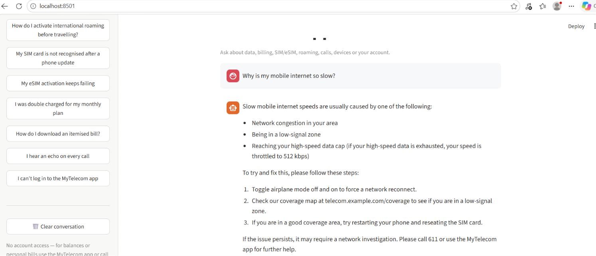
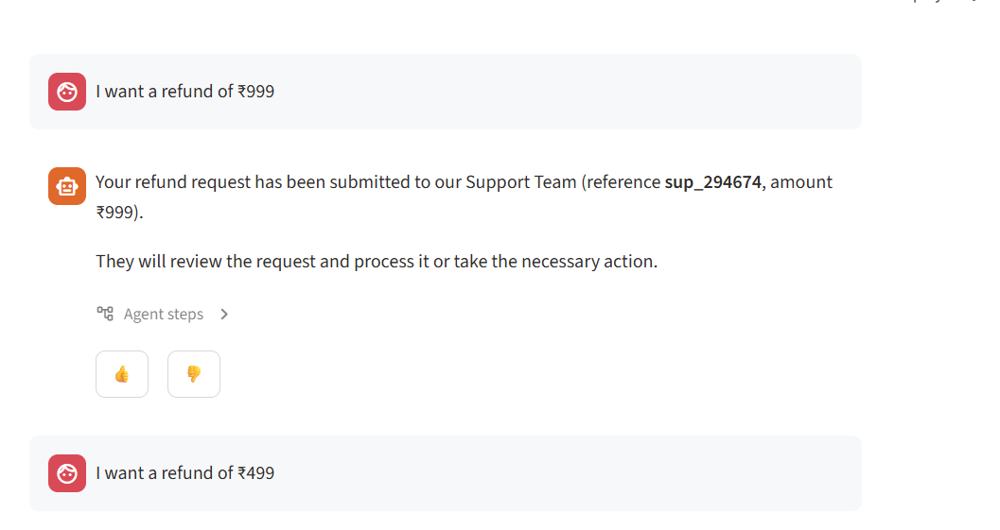

# 📶 NovaCell Telecom Support Chatbot — a RAG project

A customer-support chatbot for a fictional mobile operator, NovaCell. It answers everyday (Tier-1) questions about mobile data, billing, SIM/eSIM, roaming, calls and accounts, **using only the company's own knowledge**: an FAQ, a database of past resolved support tickets, and a PDF user guide.

It uses **Retrieval-Augmented Generation (RAG)**: for each question it first searches the three sources for relevant passages, then asks an LLM to answer *only* from those passages and to show its sources. If the answer isn't in the knowledge base, it says so and points the customer to a human (call 611) instead of making something up.

It also has an **agentic refund capability**: it recognises when a customer wants a recharge refunded, looks up their (simulated) account with tools, checks eligibility with fixed business rules, asks for explicit confirmation, and then performs a simulated refund, or hands larger refunds to the Support Team.

Built from two product requirements documents: [PRD.md](PRD.md) (the RAG chatbot; problem brief: [PROBLEM_STATEMENT.txt](PROBLEM_STATEMENT.txt)) and [agent_PRD.md](agent_PRD.md) (the refund agent).



## Features

- 💬 **Chat web app** (Streamlit) with streamed answers, clickable sample questions and a "Clear conversation" button
- 📚 **Searches three sources in parallel**: FAQ, resolved tickets and PDF guide, taking the top 3 matches from each
- 🔎 **Sources shown with every answer** (e.g. `FAQ-10`, `TK-004`, `telecom_guide.pdf p.5`)
- 🛡️ **Answers only from the knowledge base**, with a fixed "I don't have enough information, please call 611" fallback
- 🔒 **Respects privacy limits**: it has no account access, so it explains that instead of guessing a customer's balance or bill
- 👍👎 **Feedback buttons** plus an interaction log (question, answer, sources, response time, whether it had to escalate)
- ⌨️ **CLI mode** for use in a terminal
- 🔁 **Easy to update knowledge**: support staff edit the CSV, database or PDF and re-run one ingest script
- 🧭 **Intent routing**: each message is classified as a support question (`requirement_inquiry`) or a refund request (`refund_request`)
- 🤖 **Tool-using Refund Agent** with confirm/cancel buttons, a step-by-step "Agent steps" log, and a demo-account panel
- 💬 **Conversation memory**: the last 4 exchanges are passed to both routes, so follow-ups like "Should I do that before I travel?" work

## How it works

```
User message
     │
     ▼
Intent detection (LLM, structured output)
     ├── requirement_inquiry ──→ RAG pipeline (below)
     └── refund_request ───────→ Refund Agent (see "Refund agent")
```

### RAG pipeline

```
User question
     │
     ▼
Merged retriever (3 searches in parallel)
  ├── ChromaDB · faq       → top-3 FAQ entries
  ├── ChromaDB · tickets   → top-3 resolved tickets
  └── ChromaDB · guides    → top-3 PDF guide chunks (600 chars, 100 overlap)
     │
     ▼  9 passages, each labelled with its source
Prompt: "answer ONLY from this context, else say you don't know"
     │
     ▼
Qwen 27B on Groq (temperature 0) → answer streamed to the UI, with sources
```

The search query is always the customer's raw question; conversation history is only added to the prompt, so it never changes what is retrieved.

### Refund agent

```
Refund request
     │
     ▼
LLM agent calls tools: get_user_account → validate_refund(amount)
     │       (it can't call process_refund or submit_to_support)
     ▼
Code checks the result (no LLM decides eligibility)
     ├── not eligible ──────→ explain why (too old, already refunded, exceeds recharge…)
     ├── eligible, ≤ ₹499 ──→ ask "Confirm refund / Cancel"
     │                           └── confirmed → process_refund() → simulated refund reference
     └── eligible, > ₹499 ──→ submit_to_support() → "submitted to our Support Team"
```

Guardrails, all enforced in code:

- **Rules are code, not the LLM.** Eligibility checks are fixed: the recharge must be completed, within 7 days and not already refunded, and the amount must be above zero and no more than the recharge.
- **Explicit confirmation.** A refund runs only after an explicit "Yes, proceed" (or the Confirm button) in a later message. Ambiguous replies like "maybe" get the question again.
- **Approval limit.** Refunds above ₹499 are never processed by the app. They go to the Support Team, and the bot never claims an outcome.
- **No invented amounts.** The agent uses only an amount the customer stated or picked. If none was given, it offers the single eligible recharge, or asks which one when there are several.
- **Sensitive tools hidden.** `process_refund` and `submit_to_support` are never offered to the LLM, and both re-validate before acting.
- **Session account only.** The user ID comes from the (simulated) session and is never asked for. The customer's claims can't override the account data.

The refund is simulated. There's no real billing or payment system, and the demo account (`account_data.py`) has a ₹999 and a ₹499 recharge.

## Example results

Live test run against the real model:

| Question | What the bot did | First token |
|---|---|---|
| "Why is my mobile internet so slow?" | Step-by-step fix taken from the FAQ | 0.74 s |
| "I was charged for roaming after coming back from Spain" | Explained using a similar resolved ticket (TK-004); noted it can't see the customer's bill | 0.26 s |
| "What is my current account balance?" | Said it has no account access; pointed to the app / `*123#` | 0.25 s |
| "Who won the 2022 football World Cup?" | Declined: "I don't have enough information… call 611" | 0.25 s |

Refund agent, all seven scenarios from [agent_PRD.md](agent_PRD.md), checked by `demo_scenarios.py` against the live model:

| Scenario | Message | Outcome |
|---|---|---|
| 1. Successful refund | "I want a refund of ₹499." → "Yes, proceed" | Asks for confirmation, then refunds with a reference like `ref_3dd4d6` |
| 2. Exceeds recharge | "Give me a refund of ₹2,000." | Rejected: exceeds the ₹499 recharge |
| 3. Too old | "I want a refund of ₹499." (recharge 15 days old) | Rejected: outside the 7-day window |
| 4. Already refunded | "I want a refund of ₹499." (already refunded) | Rejected: already refunded |
| 5. Normal question | "Why is my mobile internet slow?" | Routed to RAG, answered with sources |
| 6. Above limit | "I want a refund of ₹999." | Submitted to the Support Team; no confirmation, no refund |
| 7. Follow-up | "How do I activate international roaming?" → "Should I do that before I travel?" | "that" understood as activating roaming |



Example workflow log for scenario 1 (shown under each answer as "Agent steps"):

```
[Intent] refund_request
[Agent] get_user_account
[Agent] validate_refund(amount=499)
[Validation] eligible=True
[Agent] awaiting_user_confirmation
[User] confirmed
[Agent] process_refund(amount=499)
[Refund] success refund_id=ref_3dd4d6
```

## Tech stack

| Part | Tool |
|---|---|
| Orchestration | LangChain (LCEL) |
| Vector database | ChromaDB (saved on disk) |
| Embeddings | `all-MiniLM-L6-v2`, run locally via ONNX Runtime (no embedding API cost) |
| LLM | `qwen/qwen3.8-27b` on Groq |
| UI | Streamlit |
| Data | CSV (FAQ), SQLite (tickets), PDF (guide, parsed with pypdf) |

## Run it yourself

Requires Python 3.11+ and a free [Groq API key](https://console.groq.com).

```powershell
git clone <this repo's URL>
cd <repo folder>
python -m venv .venv
.venv\Scripts\pip install -r requirements.txt
copy .env.example .env          # then paste your GROQ_API_KEY into .env
.venv\Scripts\python.exe ingest_all.py
.venv\Scripts\streamlit.exe run app.py
```

Then open http://localhost:8501. For the terminal version, run `.venv\Scripts\python.exe main.py` (type `clear` to reset, `quit` to exit).

To try the refund agent, use the "Try a refund" buttons in the sidebar. The **Demo account** panel shows the simulated recharges, and its **Scenario data** menu switches to the "15 days old" and "already refunded" data from the PRD scenarios.

### Tests

```powershell
.venv\Scripts\python.exe -m unittest discover tests   # refund rules and guardrails, offline (no API key)
.venv\Scripts\python.exe demo_scenarios.py            # all 7 PRD scenarios against the live model
```

On macOS/Linux, use `.venv/bin/` instead of `.venv\Scripts\` and `cp` instead of `copy`.

## Updating the knowledge base

| Change | Re-run |
|---|---|
| Edit `data/faq.csv` | `python ingest_faq.py` |
| Add resolved tickets to `data/tickets.db` | `python ingest_tickets.py` |
| Replace `data/telecom_guide.pdf` | `python ingest_guides.py` |

Each script rebuilds only its own collection, so it's safe to re-run. Restart the app afterwards. Only tickets with `status = 'resolved'` are used.

**Adding a new source:** write an `ingest_<name>.py` (using `config.rebuild_collection`) and add the collection to `COLLECTIONS` in `retriever.py`.

## Project structure

| File | Purpose |
|---|---|
| `config.py` | Paths, model names, embedding and ChromaDB helpers |
| `ingest_faq.py`, `ingest_tickets.py`, `ingest_guides.py`, `ingest_all.py` | Load each source into `chroma_store/` |
| `retriever.py` | Parallel search across the three collections, with source labels |
| `rag_chain.py` | Prompt (with conversation history), LLM, streaming, and the interaction/feedback log |
| `intent.py` | Classifies each message as `requirement_inquiry` or `refund_request` |
| `assistant.py` | Routes each message to RAG or the Refund Agent; keeps per-session history |
| `refund_agent.py` | Tool-calling Refund Agent, confirmation handling and refund state machine |
| `refund_tools.py` | `get_user_account`, `validate_refund`, `process_refund`, `submit_to_support` (deterministic rules) |
| `account_data.py` | Hard-coded demo account and scenario presets |
| `app.py` | Streamlit web UI |
| `main.py` | Command-line chat |
| `demo_scenarios.py`, `tests/` | Live scenario checks and offline unit tests |
| `data/` | Sample knowledge sources (FAQ, tickets, guide) |

## What I learned / design decisions

- **Show sources and refuse when unsure.** The prompt allows only retrieved context and gives a fixed fallback message, so made-up answers are easy to spot and count.
- **Search each source separately.** Taking the top 3 from each source stops the FAQ (short, keyword-heavy entries) from crowding out ticket and guide results.
- **Measure escalation precisely.** An answer counts as escalated only when the bot falls back. Helpful answers that also say "call 611 if it persists" don't count against the deflection metric.
- **Fast startup.** Loading MiniLM through PyTorch took minutes on a laptop with antivirus scanning. Switching to the same model on ONNX Runtime brought startup down to a few seconds.
- **Model availability.** The PRD named `qwen3.6-27b`, which Groq no longer serves, so the model is configurable through `LLM_MODEL` in `.env`.
- **Let the LLM understand, let code decide.** In the refund agent, the LLM works out what the customer wants and calls lookup tools. Anything with money attached (eligibility, the ₹499 limit, executing a refund) is plain Python that the LLM can't call or override.
- **Confirmation as state, not as a prompt.** A small state machine (`awaiting_confirmation`, `refund_processed`, …) makes it impossible to refund before validation and an explicit "yes", whatever the model says.
- **Plain Python over a framework.** The PRD allowed LangGraph, but a few explicit states were enough, so no new dependency was added.

## Possible next steps

Hybrid search (BM25 + vectors), re-ranking, an automated evaluation set (e.g. RAGAS), handing unresolved chats to a human agent, and connecting the refund agent to a real (sandboxed) billing API with real sign-in.

## Notes

- `truststore` makes Python use the operating system's certificates, which helps behind corporate proxies or antivirus that inspect HTTPS traffic.
- The first run downloads the embedding model (~80 MB) to `~/.cache/chroma`. After that, embeddings run offline.
- All company names and data are fictional sample data for this exercise.
